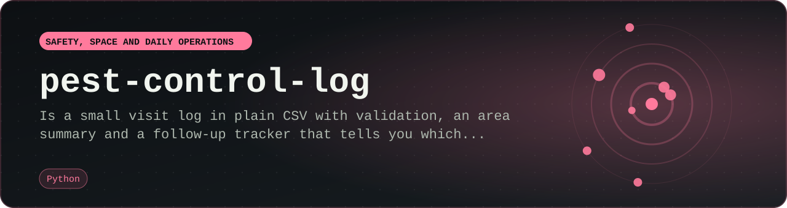
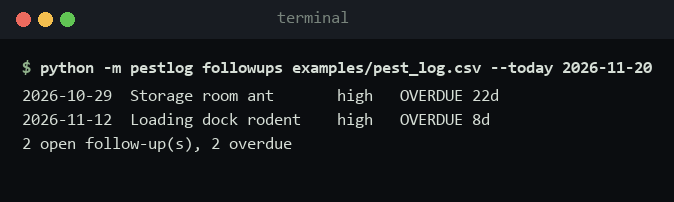

<p align="center"></p>

# pest-control-log

Pest control contractors visit, but the record of what they found and what must happen next often lives on paper. This repo is a small visit log in plain CSV with validation, an area summary and a follow-up tracker that tells you which re-visits are overdue.



## What it is for

Facility coordinators in food service, healthcare and housing need a clean record for inspections: date, area, pest, severity, action taken, technician and follow-up date. Use it to add visits from the command line, check an existing log for bad rows, see which areas keep recurring, and list follow-ups that nobody closed.

## Install

```
git clone https://github.com/yassine2med/pest-control-log
cd pest-control-log && pip install -r requirements.txt
```

## How to use

| I want to | Command |
|---|---|
| Check a log for bad rows | `PYTHONPATH=src python -m pestlog validate examples/pest_log_errors.csv` |
| Summarize by area and pest | `PYTHONPATH=src python -m pestlog report examples/pest_log.csv` |
| List open follow-ups | `PYTHONPATH=src python -m pestlog followups examples/pest_log.csv --today 2026-11-20` |
| Add a visit | `PYTHONPATH=src python -m pestlog add --log my_log.csv --date 2026-11-21 --area Lobby --pest ant --severity low --action spray --technician T` |
| Show help | `PYTHONPATH=src python -m pestlog --help` |

Exit codes: 0 when fine, 1 when `validate` finds problems or `followups` finds overdue items, 2 for a missing file, a rejected entry or a bad option.

Example:

```
PYTHONPATH=src python -m pestlog followups examples/pest_log.csv --today 2026-11-20
```

Output:

```
2026-10-29  Storage room ant       high   OVERDUE 22d
2026-11-12  Loading dock rodent    high   OVERDUE 8d
2 open follow-up(s), 2 overdue
```

Summary report:

```
area           visits  worst   latest
Kitchen             3  medium  none
Loading dock        2  high    high
Storage room        2  high    high
findings by pest: ant 2, cockroach 2, rodent 2
```

Validation of a log with mistakes:

```
line 2: a medium finding needs a follow_up_date
line 3: severity 'severe' is not one of ['none', 'low', 'medium', 'high']
line 4: date '11/03/2026' is not a date in YYYY-MM-DD form
line 5: follow_up_date is before the visit date
0 valid visit(s), 4 problem(s)
```

Run the tests with `python -m pytest -q`.

## How it works

1. Each row needs a date (YYYY-MM-DD), area, pest, severity (`none`, `low`, `medium`, `high`), action and technician.
2. A `medium` or `high` finding must carry a follow-up date that is not before the visit.
3. A follow-up counts as closed when a later visit to the same area and pest exists in the log.
4. `followups` shows what is still open, most overdue first. `add` validates before it writes, so a bad entry never reaches the file.

## Limits

- One CSV file, no attachments or photos.
- Closing a follow-up is inferred from a later visit; there is no manual close flag.
- It records findings. It does not decide treatment or replace your licensed contractor's own report.

## License

MIT. Yassine Emhamed, 2026.
